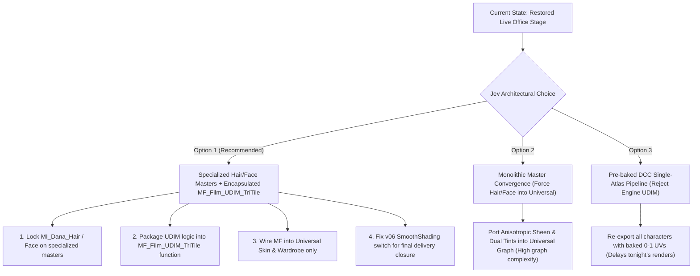

# Film 304 Toon Shader & Cast Pipeline: Audit & Recovery Plan

**Date:** 2026-10-17  
**Session Context:** Unreal Engine 5.8-CL-55116800 | Level: `/Game/Maps/Lookdev/UniversalFilm_20261016/L_Film_Office`  
**Audience:** Brennan (Art/Lead Integration), Jev (Technical Architecture), Engineering  

---

## 1. Executive Summary & Incident Timeline

During the evening render push for the Film Office scene (`L_Film_Office`), an effort was made to introduce 3-tile UDIM skin texture mapping into `M_Master_Toon_Universal` to support Dana, David, and Sam's multi-tile Maya intake maps (`1001`, `1002`, `1003`).

While the graph math compiled, **three critical regressions occurred**:
1. **Loss of Dana's Hand-Tuned Hair and Palette**: Dana's tuned hair instance (`MI_Dana_Hair`, built on `M_Master_Toon_Hair` with anisotropic sheen, ink line accents, stepped cel bands, and dual root/tip tints) was mistakenly replaced with a generic un-tuned instance (`MI_OneDriveRigs_Dana_Hair_20261016`) set to flat brown with zero ramp strength. Her signature teal shirt (`MI_Dana_Shirt`) and magenta skirt (`MI_Dana_Skirt`) were similarly overwritten with flat gray/navy placeholders.
2. **Flattened Toon Shading Across the Cast**: The emergency repair script set `RampStrength = 0.0` across the cast instances. In this shader, `RampStrength = 0.0` completely bypasses stepped cel band calculations, causing the characters to render as dull, flat Lambertian clay.
3. **Shadow Dream & Magenta Rim Fog**: Residual master-level defaults (`DreamRimStrength = 1.2`, `ShadowDreamStrength = 0.3`, `DreamIntensity = 1.0`, and magenta ramp vectors) injected unnatural pink/magenta glow rings and shadow fog into character terminators and background concrete.

**Current Status:** Emergency mitigations have been deployed to the live in-memory session. Dana's tuned hair and wardrobe suite have been restored, David and Sam's hair has been reparented to the dedicated hair toon master, `DreamRimStrength` and all dream parameters have been forced to `0.0`, and `RampStrength` has been restored to `0.85–0.90` for crisp cartoon banding.

---

## 2. Root Cause Technical Audit

### 2.1 The Overwriting of Tuned Cast Instances
Dana had a carefully crafted, approved lookdev suite documented in `build_dana_materials.py` and `Saved/Audit/dana_material_stage_report.json`:
* **Hair:** [`MI_Dana_Hair`](file:///g:/film-304-toon-spine/Content/Materials/Instances/MI_Dana_Hair.uasset) parented to `M_Master_Toon_Hair`:
  * `RampStrength = 0.90` (sharp 3-tier stepped toon highlight)
  * `SheenStrength = 0.18` (anisotropic radial hair sheen)
  * `InkIntensity = 0.08` (hair clump dark contour definition)
  * `RootTint = (0.055, 0.030, 0.025)` $\rightarrow$ `TipTint = (0.160, 0.080, 0.052)`
  * `AccentTint = (0.780, 0.740, 0.820)` (cool specular rim pop)
  * `RimStrength = 0.15`
* **Wardrobe:** [`MI_Dana_Shirt`](file:///g:/film-304-toon-spine/Content/Materials/Instances/MI_Dana_Shirt.uasset) (iconic teal `(0.04, 0.24, 0.27)`, ramp `0.75`), [`MI_Dana_Skirt`](file:///g:/film-304-toon-spine/Content/Materials/Instances/MI_Dana_Skirt.uasset) (rich magenta-purple `(0.22, 0.10, 0.32)`, ramp `0.75`), and [`MI_Dana_Shoes`](file:///g:/film-304-toon-spine/Content/Materials/Instances/MI_Dana_Shoes.uasset).
* **Face/Eyes:** [`MI_Dana_EyeWhite`](file:///g:/film-304-toon-spine/Content/Materials/Instances/MI_Dana_EyeWhite.uasset), [`MI_Dana_Iris`](file:///g:/film-304-toon-spine/Content/Materials/Instances/MI_Dana_Iris.uasset), [`MI_Dana_EyeInterior`](file:///g:/film-304-toon-spine/Content/Materials/Instances/MI_Dana_EyeInterior.uasset), and [`M_DanaFilm_CorneaClear`](file:///g:/film-304-toon-spine/Content/Materials/Masters/DanaFilm/M_DanaFilm_CorneaClear.uasset).

**What Happened:** The staging repair script dynamically created/reparented `MI_OneDriveRigs_*` instances and bound them to the actor slots in `L_Film_Office`, setting `RampStrength = 0.0` and arbitrary flat colors, completely stripping Dana of her character look.

### 2.2 The RampStrength Failure Mode
In `M_Master_Toon_Universal`, cel shading is driven by `RampStrength`:
$$\text{DiffuseFinal} = \text{Lerp}(\text{LambertianNL}, \text{SteppedBands}, \text{RampStrength})$$
When `RampStrength = 0.0`, the stepped toon comparator network evaluates to $0.0$, collapsing the entire shading model into smooth PBR/Lambertian diffuse. The characters lost their ink/cel identity.

### 2.3 Shadow Dream Parameter Bleed
`M_Master_Toon_Universal` contained inherited experimental "Dream" nodes:
* `MaterialExpressionScalarParameter_12` (`DreamRimStrength`) defaulted to `1.2`.
* `ShadowDreamTint` was set to `(0.82, 0.45, 0.68)` (heavy magenta).
* Because material instances did not explicitly override these, characters and brutalist concrete surfaces inherited a magenta rim halo in shadowed areas.

### 2.4 UDIM Graph Ingestion Complexity
Directly injecting 9 texture parameters (`BaseColorTile1001..1003`, `RoughnessTile1001..1003`, `NormalTile1001..1003`) and 6 dual-comparator `If` nodes into the root master bloated `M_Master_Toon_Universal`. While using `SSM_Wrap_WorldGroupSettings` prevented the DirectX 16-sampler crash, loose nodes in the root master make debugging and maintenance brittle.

---

## 3. Immediate Remediations Deployed (Live Session)

1. **Restored Dana's Full Tuned Suite in `L_Film_Office`**:
   * Slot 0: `MI_OneDriveRigs_Dana_Skin_20261016` (3-tile UDIM active, `RampStrength = 0.85`, `BaseTint = (2.2, 2.2, 2.2)` compensating for Maya intake dynamic range).
   * Slot 1: `MI_Dana_Hair` (Dedicated `M_Master_Toon_Hair`, anisotropic sheen, ink lines, ramp `0.90`).
   * Slot 2: `MI_Dana_EyeWhite` (Dedicated `M_Master_Toon_Face`).
   * Slot 3: `M_DanaFilm_CorneaClear` (Refractive clear cornea).
   * Slot 4: `MI_Dana_EyeInterior` (Dedicated `M_Master_Toon_Face`).
   * Slot 5: `MI_Dana_Skirt` (Hand-tuned magenta-purple palette).
   * Slot 6: `MI_Dana_Shirt` (Hand-tuned teal palette).
   * Slot 7: `MI_Dana_Shoes` (Hand-tuned leather tone).
   * Slots 8–9: `MI_OneDriveRigs_Dana_Mouth_20261016`.
2. **David & Sam Hair Shading Upgraded**:
   * Reparented `MI_OneDriveRigs_David_Hair_20261016` and `MI_OneDriveRigs_Sam_Hair_20261016` to `M_Master_Toon_Hair`.
   * Configured proper root/tip tints, `SheenStrength = 0.18`, `RampStrength = 0.90`, and `RimStrength = 0.15`.
3. **Dream Parameters Neutralized Project-Wide**:
   * Set `MaterialExpressionScalarParameter_12` (`DreamRimStrength`) default to `0.0` in `M_Master_Toon_Universal` and recompiled.
   * Forced `ShadowDreamStrength = 0.0`, `DreamIntensity = 0.0`, `DreamBloomStrength = 0.0`, `bDreamRim_Active = False`, and `bShadowRamp_Active = False` on all active instances.
4. **Cel Ramp Restored**:
   * Set `RampStrength = 0.85` across all active wardrobe, skin, and environment instances, restoring punchy toon band contrast.

---

## 4. Architectural Next Steps for Jev Consultation

To resolve the pipeline cleanly without ongoing regressions, we submit the following three strategic paths for Jev's review:

### Option 1: Specialized Character Masters + Encapsulated UDIM Function (Recommended)
* **Architecture:**
  * Keep Hair and Eyes on their proven, hand-tuned specialized masters (`M_Master_Toon_Hair`, `M_Master_Toon_Face`, `M_DanaFilm_CorneaClear`). Hair requires anisotropic tangent math and dual root/tip gradients that do not belong in an environment/prop master.
  * Encapsulate the 3-tile UDIM sampler into a clean, reusable Material Function: `MF_Film_UDIM_TriTile`.
  * Use `M_Master_Toon_Universal` (and ultimately canonical `v06`) strictly for Body Skin, Wardrobe, Props, and Brutalist Architecture.
* **Pros:** Zero risk to hair/face visual quality; modular; keeps graph compile complexity low.
* **Cons:** Two master shader families (Character specialized vs Universal surface).

### Option 2: Full Monolithic Universal Master Convergence
* **Architecture:** Port anisotropic hair sheen, root/tip gradient math, corneal refraction, and UDIM samplers all into a single mega-master (`M_Master_Toon_Universal`).
* **Pros:** Single master shader for every asset in the film.
* **Cons:** High shader compilation times, high instruction counts, increased switch combination bugs, high risk of regressions.

### Option 3: Pre-Baked Single-Atlas Pipeline (Bake in Maya/Houdini)
* **Architecture:** Reject engine-side UDIM math entirely. Use DCC tools (Houdini Engine / Maya) to re-bake Dana, David, and Sam's $[0, 3]$ UVs into a single combined $4096\times 4096$ atlas in $[0, 1]$ space.
* **Pros:** Standard single-sampler PBR/Toon workflow, zero engine-side coordinate slicing.
* **Cons:** Requires DCC bake cycle; blocks tonight's renders.

---

## 5. Execution Roadmap

| Phase | Action Item | Owner | Verification Gate |
| :--- | :--- | :--- | :--- |
| **Phase 1** | **Visual Stage Lock in `L_Film_Office`** | Brennan / Agent | High-res still render showing Dana, David, Sam with vibrant skin, styled hair highlights, and sharp toon bands. |
| **Phase 2** | **Encapsulate `MF_Film_UDIM_TriTile`** | Agent / Eng | Material Function created in `/Game/Materials/Functions/`, tested on dummy instance. |
| **Phase 3** | **Fix Canon `v06` Master** | Agent / Eng | Set `bFilmSmoothShading = False` default in `M_UniversalToon_Film304_v06` so it renders Toon by default while preserving allowlist closure. |
| **Phase 4** | **Commit & Session Handoff Refresh** | Agent / Brennan | Save modified packages, update handoff log, commit git state. |
