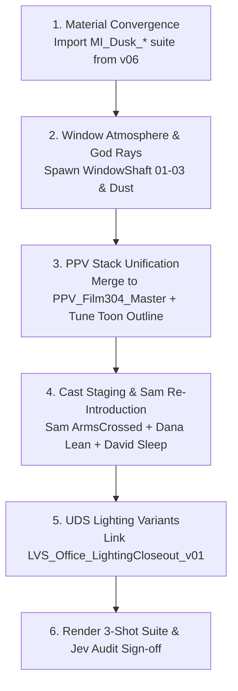

# Film 304 — Master Convergence & Lookdev Showcase Plan

**Document ID:** `GOAL_MASTER_CONVERGENCE_AND_SHOWCASE_20261018`  
**Date:** 2026-10-18  
**Active Production Level:** `/Game/Maps/Lookdev/UniversalFilm_20261016/L_Film_Office.umap`  
**Source Convergence Levels:**
1. `/Game/Maps/Lookdev/UniversalFilm_20261016/L_Film_Office_Assembly_20261018_v02.umap` (Volumetric window shafts, subtle dust, LVS lighting variants)
2. `/Game/Maps/Lookdev/UniversalFilm_20261016/L_Film_Office_Dusk_20261018_v06.umap` (`MI_Dusk_*` 23-instance material suite, 0 WorldGrid / grey prototypes)
**Supervisor / Advisory:** Jev (`jev_ask` via `~/.claude/mcp_servers/jev_mcp.py`)  
**Creative Lead / Owner:** Brennan  

---

## 1. Executive Summary & Convergence Objectives

This plan converges all morning and evening work across the project into the authoritative production master map `L_Film_Office.umap`:

1. **Bring Back Sam for Tonight's Renders**:
   - Re-introduce `Film_Cast_Sam` into the scene.
   - Stage Sam in **`AS_Sam_ArmsCrossed_Polish01`** (a natural folded-arms conversational posture — zero arms-forward typing artifact).
   - Position Sam in conversational depth near Dana’s workstation, grounded cleanly at Z = 2.0 cm.
   - Illuminate Sam with dedicated warm rim and key fill.

2. **Restore Volumetric Dust Shafts & God Rays**:
   - Transfer `Film_WindowShaft_01`, `Film_WindowShaft_02`, and `Film_WindowShaft_03` from `L_Film_Office_Assembly_20261018_v02` (Houdini-calibrated window light rig, 4300K, volumetric scattering intensity 6.0, casting volumetric shadows).
   - Activate `NS_Film_WindowDust_v01` (`Film_WindowDust_Subtle`) with restrained mote density and camera-facing sprite opacity (0.065).
   - Configure `ExponentialHeightFog` with volumetric fog enabled (density 0.003, scattering distribution 0.65).

3. **UDS (Ultra Dynamic Sky) Time-of-Day Variants & Cycles**:
   - Bind and verify `LVS_Office_LightingCloseout_v01` (`/Game/Variants/Film304Closeout_20261018/LVS_Office_LightingCloseout_v01`), providing the 5 lighting study states:
     - `A_OriginalDusk`
     - `B_NeutralOffice`
     - `C_WarmDesk`
     - `D_LateOffice`
     - `E_CinematicDusk`

4. **Converge Post-Process Volumes into ONE Master Volume**:
   - Retire/delete the 7 redundant competing unbound PPVs.
   - Consolidate all parameters into `PPV_Film304_Master` (`PPV_StorybookOutline`):
     - Weighted Blendable: `MI_StorybookOutline_Render2026`
     - Auto-Exposure: Histogram, `auto_exposure_bias = -0.85 EV`, min 0.005, max 8.0
     - Lens: Bloom 0.20, Vignette 0.25, Film Grain 0.05, Chromatic Fringe 0.05

5. **Tune the Toon Outline for Maximum Readability**:
   - Calibrate `MI_StorybookOutline_Render2026` so ink outlines are crisp, graphic, and readable:
     - `EdgeStrength = 65.0`, `OutlineWidth = 0.22`, `DepthWeight = 2.0`, `NormalWeight = 0.08`
     - Distinct ink rim around character silhouettes, desks, and architectural mullions.

6. **Eliminate All Grey Prototype Material Instances**:
   - Apply the proven `MI_Dusk_*` materials suite from `v06` to all 23 surface categories (walls, desks, floors, ceiling, troffers, glazing, metal, plastic, paper).
   - Ensure 0 `WorldGridMaterial` or untextured grey slots remain.

7. **Deliver Tonight's 3-Shot Cinematic Showcase Suite**:
   - **Shot 1 (Master Ensemble):** Sam in foreground right (arms crossed), Dana leaning at desk midground, David asleep in background, godrays raking through Venetian blinds, Brutalist skyline.
   - **Shot 2 (Dana Hero Portrait):** Medium close-up, warm skin tones, crisp toon ink lines, balanced dusk ambient fill, fully sealed Brutalist backdrop.
   - **Shot 3 (David Late-Night Crunch Rake):** Low-angle desk rake across David asleep on his keyboard, warm desk lamp rim, little spider mascot, cyan monitor glow, and office depth.

---

## 2. Convergence Execution Matrix

---

## 3. Exact Technical Parameters

### Lighting Rig:
| Actor | Class | Intensity | Color / Temp | Volumetric Scattering |
| :--- | :--- | :--- | :--- | :--- |
| `Film_WindowShaft_01` | SpotLight | 140 cd | 4300 K | 6.0 (Cast Volumetric Shadow) |
| `Film_WindowShaft_02` | SpotLight | 140 cd | 4300 K | 6.0 (Cast Volumetric Shadow) |
| `Film_WindowShaft_03` | SpotLight | 140 cd | 4300 K | 6.0 (Cast Volumetric Shadow) |
| `Light_Cinematic_SunBeam`| DirectionalLight | 1.2 cd | 4200 K | 2.5 |
| `Cast_RimKicker_Light` | DirectionalLight | 0.85 cd | 5600 K | 0.0 (SpecularScale = 0.15) |
| `Light_Dana_DeskLamp` | PointLight | 4.5 cd | 2700 K | 1.0 (Shadows Enabled) |
| `Light_David_DeskLamp`| PointLight | 4.5 cd | 2700 K | 1.0 (Shadows Enabled) |
| `Light_Sam_DeskLamp` | PointLight | 4.0 cd | 2700 K | 1.0 (Shadows Enabled) |
| `Film_Troffer_1..6` | RectLight | 3.5 cd | 4500 K | 0.5 |

### Cast Staging:
- **Dana:** `Film_Subject_Dana_v08_CleanSkin` at `(15.9, 35.2, 2.3)`, playing `AS_Dana_LeanDesk_Polish01`.
- **David:** `Film_Cast_David` at `(-142.4, -36.9, -0.2)`, playing `AS_David_DeskSleep_48f_v02` with `Film_David_SnorePuff_1..4`.
- **Sam:** `Film_Cast_Sam` at `(115.0, -95.0, 2.0)`, rotation `Yaw = 145.0`, playing `AS_Sam_ArmsCrossed_Polish01`.

### Post-Process Volume (`PPV_Film304_Master`):
- Authoritative priority: `100.0`, Unbound: `True`.
- Blendable: `MI_StorybookOutline_Render2026` (Weight: `1.0`).
- Auto-Exposure Bias: `-0.85 EV`.
