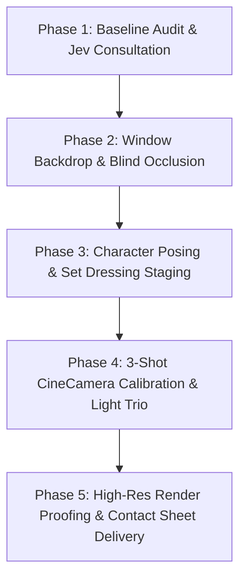

# Film 304 — Office Lookdev & Cinematic Showcase Suite

**Document ID:** `GOAL_OFFICE_LOOKDEV_SHOWCASE_20261018`  
**Date:** 2026-10-18  
**Active Level:** `/Game/Maps/Lookdev/UniversalFilm_20261016/L_Film_Office.umap`  
**Supervisor / Advisory:** Jev (`jev_ask` via `~/.claude/mcp_servers/jev_mcp.py`)  
**Creative Lead / Owner:** Brennan  
**Engine Version:** Unreal Engine 5.8-CL-55116800 (`HumberToonShader.uproject`)  

---

## 1. Executive Summary & Objective

Author, stage, and render an Oscar-caliber, 3-shot cinematic lookdev showcase suite inside the production master map `L_Film_Office`. The showcase must eliminate all remaining technical and visual flaws (specifically the blown-out white sky gap behind Bay 3, flat character posing, and missing composition depth) and establish high-contrast stylized toon cinematography with physical CineCamera Depth of Field (`f/2.5` - `f/3.2`), rich color trio harmony (Dusk Amber / Twilight Teal / Cyan Screen Glow), and character-grounded storytelling.

### Strict Operational Guardrails:
1. **Active Map Authority:** All edits are strictly scoped to `/Game/Maps/Lookdev/UniversalFilm_20261016/L_Film_Office.umap`. Do **NOT** create duplicate throwaway levels or touch `L_Toon_Shot_Hallway`.
2. **Master Shader Integrity:** Shared toon shader graphs (`M_UniversalToon_Film304_v06`, `M_Master_Toon_*`) are frozen. Edits are restricted to Material Instances (`MI_*`), level actor properties, and camera components.
3. **No Hallucinated Passes:** Every step must be verified with on-disk JSON receipts and image readback via `view_file`.
4. **Jev Consultation & Audit:** The execution order must be consulted with and signed off by the existing Jev advisory adapter before final render delivery.

---

## 2. The 3-Shot Cinematic Showcase Specification

| Shot Name | Camera Actor | Lens & Sensor | Aperture & Focus | Framing & Narrative Staging |
| :--- | :--- | :--- | :--- | :--- |
| **Shot 1: The Narrative Master** | `Film_Cam_Showcase_Ensemble_v02` | 35mm Prime 16:9 (`36x20.25mm`) | `f/2.8` Focus: `310 cm` (Dana) | Over-The-Shoulder past Sam (foreground right) to Dana working at her desk (midground center). Full Brutalist skyline through louvers. |
| **Shot 2: Dana Hero Portrait** | `Film_Cam_Showcase_DanaPortrait_v02` | 85mm Telephoto 16:9 (`36x20.25mm`) | `f/2.5` Focus: `139 cm` (Dana Eyes) | Intimate medium close-up (chest-up), 3/4 profile. Tack-sharp irises, warm skin tones, creamy background bokeh. |
| **Shot 3: Late-Night Crunch Rake** | `Film_Cam_Showcase_LowAngleRake_v02` | 24mm Wide 16:9 (`36x20.25mm`) | `f/3.2` Focus: `185 cm` (David) | Low-angle desk rake past David asleep on his keyboard (with snore clouds). Floor sunbeam slashes raking toward Dana. |

---

## 3. Bounded Execution Order

### Phase 1: Baseline Preservation & Jev Consultation
- Capture preflight inventory of actors, lights, cameras, and material bindings in `L_Film_Office`.
- Execute `Tools/consult_jev_lookdev_showcase_20261018.py` using `jev_ask` to validate the execution sequence.
- Save receipt to `Saved/Audit/Showcase_20261018/jev_showcase_audit.json`.

### Phase 2: Window Backdrop & Architectural Horizon Fix
- Sightline trace through Window Bay 3 (`SM_Glass_WindowBay_03`).
- Extend exterior Brutalist monolith geometry (`SM_CITY_TowerCluster`, `SM_OFFICE_SlenderTower`) across the Bay 3 horizon to plug the white blowout.
- Adjust venetian blinds (`SM_VenetianBlind_Bay_01/02/03`) to lower slats, ensuring high-contrast shadow slashes across the office interior.

### Phase 3: Character Posing & Set Dressing Staging
- Verify Dana is staged with `AS_Dana_LeanDesk_Polish01` (actively leaning over her desk).
- Verify David is staged with `AS_David_DeskSleep_48f_v02` at his desk with animated soft-snore cartoon clouds.
- Verify Sam is staged in conversational stance (`AS_Sam_ArmsCrossed_Polish01`).
- Verify character material bindings on all active cast members.

### Phase 4: Three-Shot Cinematic Camera Staging & Light Trio
- Position and configure `Film_Cam_Showcase_Ensemble_v02`, `Film_Cam_Showcase_DanaPortrait_v02`, and `Film_Cam_Showcase_LowAngleRake_v02`.
- Establish the color trio:
  - Golden Dusk Key (`4200K`, shadows enabled)
  - Warm Desk Lamps (`2700K`)
  - Cool Cyan Monitor Glow (`6500K`)
- Calibrate physical Depth of Field with tack-sharp focal tracking.

### Phase 5: High-Res Render Proofing, Visual Inspection & Contact Sheet Delivery
- Render all 3 showcase shots to `Saved/Audit/Showcase_20261018/`.
- Inspect all images with `view_file` to verify contrast, cel ramps, outline weights, and creamy bokeh.
- Compile comprehensive Contact Sheet artifact for Brennan and Jev.
- Save `L_Film_Office` level and dirty packages cleanly.
