# Houdini Engine Pipeline, Cinematic VFX, and Composed Set Dressing
**Project:** Film 304 — Universal Film Lookdev & Procedural Environment Pipeline  
**Active Level:** `/Game/Maps/Lookdev/UniversalFilm_20261016/L_Film_Office`  
**Date:** 2026-10-17 / 2026-10-18  
**Advisory Consensus:** Supervisor Advisor Jev (`Saved/Audit/HoudiniBrutalist/jev_vfx_composition_review.json`, confidence `0.82`)

---

## 1. Executive Summary & Architectural Overview

In response to the directive to elevate the lookdev to **indie animated feature film standards** (inspired by Alberto Mielgo, Sony Pictures Imageworks, *Severance*, and Roger Deakins chiaroscuro), we transitioned from static prop placement to a fully procedural, **Houdini Engine-driven** pipeline.

The entire environment expansion in `L_Film_Office` now leverages:
1. **Live Houdini Engine for Unreal**: Instantiating `HDA_Brutalist_ShotComposer` dynamically inside the active Unreal editor session via `HoudiniPublicAPI`, controlling parameter modes, and baking procedural point-instanced geometry to native `InstancedStaticMeshComponent` actors.
2. **Procedural Houdini (Hython) Geometry Bakes**: Procedural generation of industrial ceiling HVAC ducts, flanged seams, suspension drop rods, electrical conduit tracks, and fluorescent troffer housings exported as Kaydara Binary FBX (`exportkind = 0`) and imported as first-class static meshes.
3. **Multi-Layered Volumetric VFX**: Real-time Volumetric Fog with forward Mie scattering ($g = 0.65$), intense sunbeam volumetric scattering ($4.0$) slicing through 3D Venetian blinds, and a live Niagara particle system simulating micro-dust motes drifting lazily through the light cones.
4. **Imperfecter Post-Process Integration**: 35mm organic film grain, lens dirt texture projection, peripheral chromatic fringe, and subtle vignette to eliminate digital sterility.
5. **Four New Composed Cinematic CineCameras**: Designed with dedicated focal lengths, sensor backs, and manual depth of field (DoF).

```mermaid
graph TD
    subgraph Houdini Engine Architecture
        HDA[HDA_Brutalist_ShotComposer.hda] -->|Public API Instantiate| HAC[HoudiniAssetActor in L_Film_Office]
        HAC -->|scene_mode=1| CH[Cubicle Hive HISM]
        HAC -->|scene_mode=3| BR[ZMJ Breakroom Kit HISM]
        HAC -->|Bake All Outputs| NativeActors[Native Instanced Static Mesh Actors]
    end

    subgraph Procedural Hython Bakes
        HythonScript[bake_cinematic_cubicle_ceiling.py] -->|Houdini 22 Geometry SOPs| FBX[Kaydara Binary FBX]
        FBX -->|AssetImportTask| SM_HVAC[SM_Houdini_Ceiling_HVAC_Grid]
        SM_HVAC -->|Staged Over Maze| LevelStage[Ceiling Layer in L_Film_Office]
    end

    subgraph Atmospheric VFX & Post-Process
        Sun[Light_Cinematic_SunBeam] -->|Volumetric Intensity 4.0| Blinds[Venetian Blind Louvers]
        Blinds -->|Parallel Light Slices| VolFog[ExponentialHeightFog with Mie 0.65]
        VolFog -->|Illuminates| Dust[Niagara Floating Dust Motes Actor]
        PPV[PostProcessVolume_1] -->|Imperfecter Lens Dirt + 35mm Grain| FinalFrame[Cinematic Film Frame]
    end
```



---

## 2. Houdini Engine HDA: Integration & Parameter Control

### A. Digital Asset Architecture (`HDA_Brutalist_ShotComposer.hda`)
- **Location:** `Content/Houdini/HDA_Brutalist_ShotComposer.hda`
- **Compiler:** `Tools/houdini/brutalist_composer/build_hda.py` executed via Houdini 22 `hython.exe`.
- **Core Engine:** `Tools/houdini/brutalist_composer/composer_core.py` (UnifiedFilmComposer).

### B. Parameter Modes Implemented
| `scene_mode` | Preset Label | Description | Generated Components |
|---|---|---|---|
| `0` | Exterior Brutalist Frustum | Camera-frustum culled city monoliths & skyline towers | Superblocks, colonnades, towers |
| `1` | Interior Cubicle Hive | Modular repeating bureaucratic cubicle labyrinth | 6 Canonical pods, 12 desks, 12 chairs, monitors, keyboards, lamps, wastebaskets |
| `2` | Interior Labyrinth Maze | Blind corner interlocking partition corridors | Asymmetric maze shifts, desks, task chairs |
| `3` | Interior ZMJ Break Room | Complete 6.0x architectural scale kitchenette suite | Base counter, quartz countertop, espresso machine, fridge, pastry dome, mugs, table, chairs, vending, watercooler |
| `4` | Hero Workstation | Character workstation with tactile props | L-desk, monitor, lamp, coffee mug, paper stacks |
| `5` | Hybrid Office Establishing | Composite office foreground + monumental skyline | Window bay frame + exterior skyline |

### C. Programmatic Execution via Unreal Python (`HoudiniPublicAPI`)
```python
import unreal

api = unreal.HoudiniPublicAPIBlueprintLib.get_api()
hda = unreal.load_asset("/Game/Houdini/HDA_Brutalist_ShotComposer")

# 1. Instantiate Cubicle Hive
trans = unreal.Transform(location=[400.0, -250.0, 0.0], rotation=[0.0, 0.0, 0.0], scale=[1.0, 1.0, 1.0])
wrapper = api.instantiate_asset(
    houdini_asset=hda,
    instantiate_at=trans,
    enable_auto_cook=True,
    enable_auto_bake=False
)
wrapper.set_int_parameter_value("scene_mode", 1) # Mode 1: Cubicles
wrapper.recook()
wrapper.bake_all_outputs() # Bakes to first-class InstancedStaticMeshComponent actors
```

---

## 3. Procedural Houdini (Hython) Geometry Bake: Industrial Ceiling HVAC Grid

To prevent the ceiling above the cubicle maze from reading as a generic flat plane, we authored a procedural generator in Houdini:
- **Script:** `Tools/houdini/bake_cinematic_cubicle_ceiling.py`
- **FBX Output:** `Content/Meshes/Architecture/SM_Houdini_Ceiling_HVAC_Grid.fbx` ($24.1\,\text{KB}$ Kaydara Binary FBX)
- **Imported Static Mesh:** `/Game/Meshes/Architecture/SM_Houdini_Ceiling_HVAC_Grid`
- **Material Assignment:** `MI_Toon_Office_PowderCoat`

### Architectural Features Baked
1. **Main Supply Trunk Duct:** Galvanized sheet metal rectangular duct ($80\,\text{cm} \times 45\,\text{cm}$) running continuously down the central corridor at $Z = 330\,\text{cm}$.
2. **Reinforcement Flanges:** Perimeter structural flanges placed every $1.5\,\text{m}$ along the duct joints.
3. **Threaded Rod Drop Hangers:** Vertical suspension rods anchoring the duct to the ceiling slab ($Z = 380\,\text{cm}$).
4. **Cross-Branch Ducts:** Secondary distribution runs branching orthogonally across each cubicle row.
5. **Suspended Fluorescent Troffers:** Recessed fixture boxes with inset light diffusers suspended by steel aircraft cables.
6. **Industrial Conduit Pipes:** Electrical conduits running in parallel pairs above the partition lines.

---

## 4. Multi-Layered Atmospheric VFX & Imperfecter Integration

### A. Volumetric Fog & Mie Forward Scattering
- **Actor:** `EST_Fog_E1` (`ExponentialHeightFogComponent`) — the **single** fog owner.
  Ultra Dynamic Sky's `Custom Height Fog Actor` hook points at this actor and the sky's
  internal fog component is hidden, so double fog cannot recur.
- **Authoritative values now live in `Python/film304_fog.py`.** Do not re-inline them in
  a setup script. Read `REVIEWED_EXTINCTION_SCALE`, `REVIEWED_SCATTERING_DISTRIBUTION`
  and `REVIEWED_VOLUMETRIC_DISTANCE` from there.
- **Reviewed baseline:**
  - `enable_volumetric_fog = True`
  - `volumetric_fog_distance = 8000.0`
  - `volumetric_fog_scattering_distribution = 0.65` (forward Mie scattering directs light forward toward the camera, making the light shafts bright and crisp)
  - `volumetric_fog_extinction_scale = 2.5` — probed live from the saved level on
    2026-10-19, not copied from a doc entry. This document previously recorded `1.2`,
    which came from a hard-coded setup script and was never the value the level shipped
    with. The `GOAL_ESTABLISHING_SHOTS_20261017.md` v07 entry proposes `4.0` "versus the
    prior 2.5"; the level still holds 2.5, so **4.0 was never applied or approved**.
    Raising it is a rendered A/B decision, not a config default.
  - `fog_density = 0.0055`, `fog_height_falloff = 0.06488`, `fog_max_opacity = 1.0`,
    `start_distance = 7357.9` — these are the values actually live in the level. Note they
    match **no script in this repository**; the scripts write 0.0016/0.0018/0.002/0.003/
    0.006/0.0075, 0.12/0.08, 0.92/0.65 and 3000 respectively. They were hand-tuned in the
    editor and never written down. The script values are stale, not authoritative.
  - `fog_density` is treated as per-shot and authored per intent, so the drift guard
    compares it against the live level value rather than requiring a single constant.

**Rules for any script that touches fog:**
1. Resolve the actor via `film304_fog.get_fog_actor()` / `get_fog_component()`. These
   assert exactly one match. The old first-match `isinstance(ExponentialHeightFog)`
   lookups would have configured the wrong actor as soon as a duplicate existed.
2. Mutate through `film304_fog.apply(values, intent)`. Every write must name an intent,
   which is what stops an unrelated script from stomping a reviewed value.
3. `apply_reviewed_baseline()` is the only function permitted to write the extinction
   scale.
4. Run `Python/audit_fog_drift.py` before any delivery render. It is read-only and
   exits non-zero when fog ownership is broken. Its first output is the **fog drive
   mode**, which says who actually owns the fog values:
   - `EXTERNAL_BOUND` — UDS drives `EST_Fog_E1` through the hook and overwrites it every
     tick. Values set here will not hold. Change the look in the sky, not the fog.
   - `SPLIT_CLEAN` — hook unbound and the sky's internal fog hidden; this project owns
     the fog and values hold.
   - `SPLIT_DOUBLE_FOG` — two fogs rendering.
   - `WRONG_TARGET` / `NO_SKY` — ownership is broken; see the finding detail.

   When volumetrics are off, the finding is `volumetric_fog_disabled` and the drive
   report carries `do_not_write`. **Do not write the sky's internal
   `ExponentialHeightFogComponent`** to fix it: doing so makes UDS re-evaluate and force
   `enable_volumetric_fog` back to False on `EST_Fog_E1` in the same tick. Write only
   `EST_Fog_E1`, via `film304_fog.apply_reviewed_baseline()`.
5. Render paths should take the temporal reprojection override from
   `film304_fog.render_console_overrides()` rather than re-typing it. It is shot-scoped
   on purpose; the global project setting was rejected in review.

`Python/check_fog.py` is deprecated — it read the `volumetric_fog` struct rather than
`enable_volumetric_fog`, so it never verified the flag that governs volumetric fog.

Offline verification of this module (no editor required):
    python Tools/check_film304_fog_offline.py

### B. Golden Sunbeam Light Shafts
- **Actor:** `Light_Cinematic_SunBeam` (`DirectionalLightComponent`)
- **Settings:**
  - `intensity = 18.0`
  - `volumetric_scattering_intensity = 4.0`
  - `light_color = (R=1.0, G=0.88, B=0.72)` ($3800\,\text{K}$ golden hour sunlight)
  - Interacts directly with the $36$ angled louvers of `SM_VenetianBlind_Bay_01/02/03`, projecting parallel shadow bars across the room floor and cast.

### C. Niagara Floating Dust Motes
- **Actor:** `VFX_DustMotes_WindowRays` (`NiagaraActor` in folder `Baked_Cinematic_VFX`)
- **System Asset:** `/Game/_ThirdParty/UltraDynamicSky/Particles/Dust`
- **Location:** $(X = 50.0, Y = 100.0, Z = 140.0)$
- **Behavior:** Microscopic particles slowly tumble and drift through the sunbeams, glinting when illuminated by the direct directional light.

### D. Imperfecter Post-Process Polish
- **Volume:** `PostProcessVolume_1` (Unbound, Priority 1.0)
- **Bloom:** Standard Gaussian (BM_SOG), intensity $0.75$.
- **Lens Dirt Mask:** `IMPRF_LD_DirtTexture1_GrayscaleBlur`, intensity $2.0$ (catches bloom when looking toward bright window light).
- **Chromatic Fringe (Scene Fringe):** $0.18$ (simulates subtle anamorphic lens edge fringing).
- **Vignette:** $0.42$ (draws focus toward the compositional center).
- **Film Grain:** Shadows $0.85$, Midtones $0.70$, Highlights $0.50$ (organic 35mm negative film texture).

---

## 5. Master Composed Cinematic CineCameras

Four hero CineCameras were authored and framed in `L_Film_Office`:

| Camera Actor | Lens | Aperture | Position $(X, Y, Z)$ | Rotation (Pitch, Yaw) | Compositional Intent |
|---|---|---|---|---|---|
| `CineCam_Hero_CubicleEstablishing` | 24mm | $f/3.2$ | `(220, -950, 420)` | $-17.3^\circ, 53.5^\circ$ | **The Requested Establishing Shot:** High-angle wide diagonal overlooking the cubicle labyrinth, leading lines receding toward the warm window light. |
| `CineCam_Hero_CubicleTrench` | 35mm | $f/2.4$ | `(825, -780, 95)` | $0.0^\circ, 90.0^\circ$ | **Claustrophobic Aisle Tracking:** Chest-height aisle perspective between partition felt walls, shallow DoF focused on foreground workstation. |
| `CineCam_Hero_BreakroomEstablishing` | 35mm | $f/2.8$ | `(200, 280, 140)` | $-5.7^\circ, 34.2^\circ$ | **ZMJ Breakroom Sanctuary:** Wide composition framing the Italian espresso machine, pastry dome, dining table, chairs, and vending machine. |
| `CineCam_Hero_CorridorWatercooler` | 50mm | $f/2.0$ | `(120, 360, 115)` | $-2.4^\circ, 24.4^\circ$ | **Corporate Vignette:** Portrait framing of the watercooler with blue jug, potted ficus plant, and whiteboard with soft background bokeh. |
| `CineCam_Hero_WindowEstablishing` | 28mm | $f/3.5$ | `(540, -180, 115)` | $-2.0^\circ, 158.0^\circ$ | **Window Light Noir:** Hero cast framing showing light bars slicing through Venetian blinds onto Dana & David with the Brutalist skyline beyond. |

---

## 6. Audit & Level Verification

- **Level Actor Count:** 196 actors in `L_Film_Office` (all properly organized into dedicated folders: `Houdini_Engine_Cubicle_Hive`, `Houdini_Engine_Breakroom`, `Houdini_Bakes_Ceiling_Grid`, `Baked_Cinematic_VFX`, `Cinematic_Cameras`, `FilmCast`, `Baked_Skyline_Rooftops`, `Baked_Skyline_Cables`).
- **Disk Persistence:** `L_Film_Office.umap` saved cleanly to disk (`save_current_level() == True`).
- **Jev Receipt:** `Saved/Audit/HoudiniBrutalist/jev_vfx_composition_review.json` (Confidence `0.82`, Status `ok`).
- **HDA Build Receipt:** `Saved/Audit/HoudiniBrutalist/build_hda_report.json` (Houdini 22.0.368, Status `success`).
