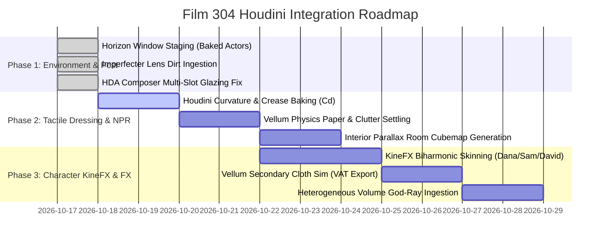

# Houdini Pipeline Research & Advanced Planning — Film 304

**Date:** 2026-10-17 · **Context:** Film 304 Toon Pipeline & Universal Film Lookdev · **Target Engine:** Unreal Engine 5.8 / Houdini 22.0.368 / Hython

---

## 1. Executive Summary & TL;DR

Houdini in modern indie animated film pipelines (e.g. Ember Lab's *Kena*, Axis Studios, Blur, Fortiche hybrid techniques) is fundamentally **an authoring engine and data compiler**, not a runtime dependency.

```
       [Houdini / Hython Foundry]                     [Unreal Engine 5.8 Production]
┌──────────────────────────────────────┐          ┌──────────────────────────────────────┐
│  • Procedural Frustum Layout         │          │  • Native Nanite & Lumen Render      │
│  • KineFX Biharmonic Skinning        │          │  • Hierarchical Instanced Meshes     │
│  • Interior Parallax Cubemaps        │ ───────► │  • Material Instances (PBR / Toon)   │
│  • Curvature / Crease Baking (Cd)    │  Bake /  │  • Movie Render Queue (MRQ)          │
│  • Vellum Physics Settling           │ Manifest │  • Zero Live Pipe / License Drift    │
│  • Volume Textures / VDBs            │          │  • 100% Deterministic Reproducibility│
└──────────────────────────────────────┘          └──────────────────────────────────────┘
```

### The Cardinal Rule: "Author Procedurally $\rightarrow$ Bake to First-Class Citizens"
* **The Live HDA Anti-Pattern:** Dropping raw `HoudiniAssetActor` nodes into cinematic Unreal levels creates brittle dependencies on background `HARS` named pipes. If cooking errors occur or asynchronous pipes timeout during Movie Render Queue (MRQ) capture, Unreal silently falls back to displaying `/HoudiniEngine/houdini_logo.houdini_logo` (a 50cm placeholder proxy invisible at distance).
* **The Production Standard:** Use HDAs interactively for art direction and tuning; immediately bake to **Unreal First-Class Citizens** (`StaticMeshActor`, `HierarchicalInstancedStaticMeshComponent` / HISM) grouped into clean Level Folders (e.g. `Baked_Brutalist_Skyline`).
* **The Headless Hython Foundry:** Run offline Python batch scripts (`hython.exe`) to execute procedural generation graphs. Hython outputs clean JSON layout manifests or FBX/USD assets, completely bypassing Unreal memory pressure and license contention.

---

## 2. Six Technical Pillars of Houdini in Film 304

### Pillar 1: KineFX Volumetric Biharmonic Skinning & Deformation Correction
* **The Problem in Current Pipeline:**
  As proven in [`Saved/OfflineIntake/20261017/melusina_assignment1/docs/TECHNICAL_BREAKDOWN.md`](file:///g:/film-304-toon-spine/Saved/OfflineIntake/20261017/melusina_assignment1/docs/TECHNICAL_BREAKDOWN.md), Maya’s headless batch export failed to smooth weights (`MFnSkinCluster` batch API limitations). Falling back to closest-distance Euclidean skinning produced severe **shoulder/armpit collapsing, tearing, and volume loss** when characters cross arms (`AS_Sam_ArmsCrossed`) or lean (`AS_Dana_LeanDesk`).
* **The Houdini Solution:**
  1. `kinefx::fbxcharacterimport`: Ingests the raw skeleton and character mesh as first-class KineFX point hierarchies.
  2. `tetembed` + `kinefx::jointcapturebiharmonic`: Generates a solid tetrahedral interior volume. Skin weights diffuse through the interior 3D flesh rather than across Euclidean surface distance, eliminating cross-limb weight bleeding between torso, biceps, and thighs.
  3. `kinefx::deltamush` / `capturecorrect`: Relaxes sharp creases while preserving volumetric anatomical muscle mass.
  4. **Automated Pose-Space Deformation (PSD):** Sweeps character joints through their functional range of motion (e.g. $0^\circ$ to $120^\circ$ elbow bend), calculates geometric volume loss, and automatically sculpts corrective blend shape morph targets, exporting them in the skeletal FBX for Unreal.

### Pillar 2: Procedural Façade Slicing & Interior Parallax Room Cubes
* **The Problem in Current Pipeline:**
  The Brutalist buildings staged outside the office window ([`SM_FAC_TowerRibbon`](file:///g:/film-304-toon-spine/Content/Environment/Brutalist/05_FACADE_VARIATION/SM_FAC_TowerRibbon.uasset) and [`SM_FAC_PunchedEstate`](file:///g:/film-304-toon-spine/Content/Environment/Brutalist/05_FACADE_VARIATION/SM_FAC_PunchedEstate.uasset)) have glass glazing slots, but appear hollow or dead when viewed through the window mullions.
* **The Houdini Solution:**
  1. **Interior Layout Synthesis:** Houdini generates a procedural interior room atlas (desks, partition cubicles, fluorescent ceiling strips, blinds, filing cabinets) across a $4\times 4$ room matrix.
  2. **Window-Grid UV Encoding:** A Python SOP / Wrangle on the building facades tags each window quad with per-primitive attributes:
     * `i@room_id`: Which room variation to display.
     * `f@blind_pct`: Window blind drop percentage ($0.0$ = open, $0.5$ = half, $1.0$ = closed).
     * `f@light_state`: Binary or randomized night/day illumination state.
  3. **Unreal Interior Parallax Mapping:**
     In Unreal, [`MI_Film304_BrutalistGlazing`](file:///g:/film-304-toon-spine/Content/Materials/Instances/Film304/Environment/MI_Film304_BrutalistGlazing.uasset) evaluates ray-traced view-vector parallax against the room cubemap. The camera moves through `L_Film_Office`, and the distant skyline reveals dynamic 3D rooms inside the towers with zero geometric polygon overhead.

### Pillar 3: Non-Photorealistic Rendering (NPR) & Toon Edge/Curvature Baking
* **The Problem in Current Pipeline:**
  The film’s cel-shaded look ([`M_PP_StorybookOutline_Render2026`](file:///g:/film-304-toon-spine/Content/Melodia/_PROJECT/04_Materials/PostProcess/Render2026/M_PP_StorybookOutline_Render2026.uasset)) uses screen-space Sobel convolution on depth/normal buffers. This exhibits two chronic visual artifacts:
  * *Coplanar Crease Blindness:* When two precast concrete slabs meet at a shallow angle ($15^\circ$–$30^\circ$), the screen-space depth jump is too subtle to trigger an ink outline, losing panel definition.
  * *Distance Aliasing:* In wide horizon shots, pixel rounding creates swimming/flickering outlines as the camera pans.
* **The Houdini Solution:**
  Houdini pre-computes curvature and feature ink lines directly onto mesh vertices (`Cd.r`, `Cd.g`, `Cd.b`):
  * **Channel R (Convex Curvature):** Highlights, ink scrape, edge wear on architectural rims.
  * **Channel G (Concave Curvature):** Dirt accumulation, shadow crease reinforcement, structural seams.
  * **Channel B (Procedural Crosshatch Coordinates):** Continuous UV field for organic hand-drawn comic hatching.
  * **Unreal Advantage:** Unreal materials read `VertexColor` natively. Lines render crisp at any camera distance, with zero screen-space swimming or post-process overhead.

### Pillar 4: Vellum Physical Prop Settling & Tactile Office Dressing
* **The Problem in Current Pipeline:**
  Manual prop dressing (paper sheets, pens, coffee mugs, open folders, computer cables) is time-consuming and inevitably suffers from props hovering $1\,\text{mm}$ above surfaces or clipping through desks.
* **The Houdini Solution:**
  1. **Vellum Soft-Body Drop:** Drop loose papers, sticky notes, and binders onto the hero desk surface under simulated gravity.
  2. Papers naturally buckle, stack, slide against each other, and drape realistically over desk edges.
  3. Once settled at frame 40, geometry is frozen with a `null` SOP and baked out to clean Unreal Static Meshes.
  4. **Secondary Cloth Motion (Vellum to VAT):**
     * Simulate secondary wrinkles and dynamic sway on Sam’s sleeves and David’s tie.
     * Export via **Vertex Animation Textures (VAT 3.0)**: Unreal plays back the cloth simulation entirely on the GPU via vertex shader displacement, maintaining full Nanite support without heavy skeletal CPU skinning.

### Pillar 5: Camera-Frustum Occlusion & Multi-Shot City Generation
* **The Problem in Current Pipeline:**
  Tonight’s sequence features 3 distinct CCAD hero CineCameras:
  * `CineCam_Hero_WindowEstablishing` (28mm Wide)
  * `CineCam_Hero_DeskLineup` (50mm Medium Portrait)
  * `CineCam_Hero_LowAngleTension` (35mm Low-Angle)
  Staging buildings by hand for one camera often breaks the silhouette of another or leaves visible horizon voids.
* **The Houdini Solution:**
  1. Ingest camera frustums ($x, y, z$, focal length, filmback, aspect ratio).
  2. Compute the **Boolean Frustum Union**:
     * Populate high-density facade details (punch windows, balconies, roof mechanical equipment) strictly inside the camera field of view.
     * Cull blind-spot geometry completely, keeping level memory lean.
  3. **Cinematic Composition Enforcement:**
     * Enforces the CCAD Golden Ratio / Rule of Thirds horizon line relative to the office window mullions.
     * Automatically assigns atmospheric depth tags (`f@depth_slice`) so distant towers naturally receive stylized aerial perspective fading.

### Pillar 6: Volumetric Atmosphere & Stylized Dust/Haze Simulation
* **The Problem in Current Pipeline:**
  Establishing shots require moody light shafts streaming through the office window glass into dusty interior air. Default screen-space bloom can feel flat and artificial.
* **The Houdini Solution:**
  1. Simulate organic micro-air currents, rising heat plumes, and suspended dust clusters with Houdini Pyro.
  2. Export as a 3D Volume Texture ($128\times 128\times 128$) or OpenVDB grid.
  3. Sample within Unreal 5.8’s **Heterogeneous Volumes** or Niagara Volume Grid emitters.
  4. Produces authentic god-rays and floating dust motes that physically interact with window mullion shadows.

---

## 3. Imperfecter Integration Architecture

The 10 imported assets under [`/Game/Textures/PostProcess/Imperfecter/`](file:///g:/film-304-toon-spine/Content/Textures/PostProcess/Imperfecter/) form a dedicated tactile post-process layer:

```
[Unreal Engine Scene Color]
        │
        ├─► [PPV_StorybookOutline] ──► Reads Sobel Edge + Vertex Color (Pillar 3)
        │
        ├─► [Bloom Dirt Mask] ──────► IMPRF_LD_DirtTexture1_GrayscaleBlur (Active @ 1.8)
        │                             (Breaks digital glare into optical lens smudges)
        │
        ├─► [Noise / Grain Pass] ───► IMPRF_NG_FilmGrainTexture
        │                             (Adds organic 35mm tooth to flat cel-shaded fills)
        │
        └─► [Film Damage Layer] ────► IMPRF_FD_ScratchesTexture + DustTexture
                                      (Subtle archival gate wear for cinematic opening)
```

### Verified Assets in Project
* `IMPRF_LD_DirtTexture1_GrayscaleBlur` (Soft bloomed lens smudges) — **Active on `PPV_StorybookOutline`**
* `IMPRF_LD_DirtTexture2_GrayscaleBlur` (Fingerprint grease & peripheral flare)
* `IMPRF_LD_DirtTexture3_Uniform` & `4_Uniform` (Optical front-element dust)
* `IMPRF_FD_DirtTexture`, `IMPRF_FD_DustTexture`, `IMPRF_FD_ScratchesTexture` (Film emulsion stains & mechanical projector scratches)
* `IMPRF_NG_DigitalNoiseTexture` & `IMPRF_NG_FilmGrainTexture` (Sensor ISO & 35mm photochemical grain)
* `M_PP_Helper.uasset` (Shader blending utility)

---

## 4. Master Phased Implementation Roadmap



### Phase Details

#### Phase 1: Horizon & Lookdev Integration (COMPLETED & LIVE)
* Cleaned unbaked `HoudiniAssetActor` proxies (`houdini_logo`) from [`L_Film_Office`](file:///g:/film-304-toon-spine/Content/Maps/Lookdev/UniversalFilm_20261016/L_Film_Office.umap).
* Baked 5 upright Brutalist actors in `Baked_Brutalist_Skyline` with [`MI_Film304_BrutalistGlazing`](file:///g:/film-304-toon-spine/Content/Materials/Instances/Film304/Environment/MI_Film304_BrutalistGlazing.uasset) window slots.
* Wired `IMPRF_LD_DirtTexture1` into `PPV_StorybookOutline.bloom_dirt_mask`.
* Recompiled [`Content/Houdini/HDA_Brutalist_ShotComposer.hda`](file:///g:/film-304-toon-spine/Content/Houdini/HDA_Brutalist_ShotComposer.hda) via Hython.

#### Phase 2: Tactile Dressing & NPR Inking
1. **Curvature Baker Script:** Author `Tools/houdini/bake_npr_curvature.py` to process the Brutalist library and office props, writing curvature into vertex colors.
2. **Vellum Clutter Generator:** Author `Tools/houdini/vellum_desk_settle.py` to drop paper piles, coffee cups, and office stationary onto the hero workstation desk, outputting a single optimized mesh.
3. **Parallax Cubemap:** Bake $4\times 4$ office window interior cubemaps and hook into `MI_Film304_BrutalistGlazing`.

#### Phase 3: Character KineFX & Atmospheric FX
1. **KineFX Biharmonic Re-skin:** Ingest the raw David, Sam, and Dana meshes; apply biharmonic volumetric binding; export polished skeletal FBXs to resolve armpit/shoulder tearing.
2. **Secondary Motion VAT:** Simulate dynamic tie and sleeve motion in Vellum; bake to Vertex Animation Textures.
3. **Volumetric God-Rays:** Export OpenVDB light-shaft density fields for Unreal 5.8 Heterogeneous Volumes.

---

## 5. Technical Specification & Attribute Reference

When authoring HDAs or Hython scripts for Unreal Engine 5.8:

### Essential Point Attributes for Houdini Engine for Unreal
| Attribute | Type | Description / Format |
| :--- | :--- | :--- |
| `unreal_instance` | `string` | Full dot-notation path: `/Game/Package/Asset.Asset` |
| `unreal_material_0` | `string` | Material instance override for Slot 0 (`Asphalt`) |
| `unreal_material_1` | `string` | Material instance override for Slot 1 (`Glazing / Windows`) |
| `unreal_material_2` | `string` | Material instance override for Slot 2 (`Concrete`) |
| `rot` | `vector3` | Euler rotation in degrees `(pitch, yaw, roll)` |
| `orient` | `vector4` | Quaternion rotation `(x, y, z, w)` |
| `scale` | `vector3` | Non-uniform scale multiplier `(sx, sy, sz)` |
| `Cd` | `vector3` | Vertex color / Curvature channel data |

### Hython Headless Execution Pattern
Always invoke Hython using absolute executable paths and detached processes:
```powershell
& "C:\Program Files\Side Effects Software\Houdini 22.0.368\bin\hython.exe" Tools/houdini/brutalist_composer/build_hda.py
```
* **Coordinate Systems:** Houdini uses right-handed Y-up (meters). Unreal uses left-handed Z-up (centimeters). In Python transformations, always enforce $\text{scale} = 100.0$ and vector mapping $(x_h, y_h, z_h) \rightarrow (x_{ue}, z_{ue}, y_{ue})$ with $\det = -1$ to avoid handedness skewing.
* **Rotator Keywords:** In Unreal Python, always pass explicit keyword arguments to avoid positional argument remapping traps:
  ```python
  unreal.Rotator(pitch=0.0, yaw=angle_deg, roll=0.0)
  ```
